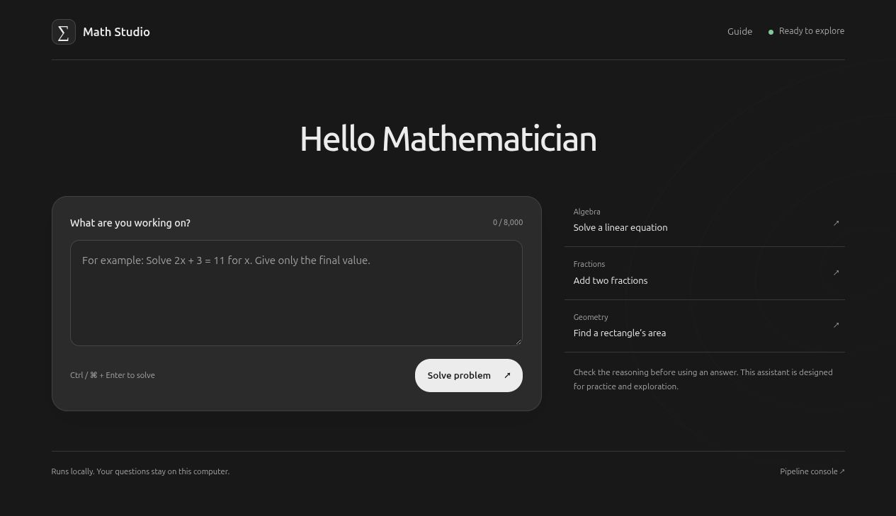

# Math Studio — Local Mathematics Assistant

A CPU mathematics practice application with a separate web workspace and pipeline console. The complete local lifecycle uses bounded data ingestion, PySpark, deterministic splits, LoRA training, DVC, MLflow experiment tracking and model serving, FastAPI, Prometheus, Grafana and Docker Compose.



## here are some commands for navigating through project, run fisrt command for reproducing whole project, run second command to evalute the existing artifacts

```bash
# Fresh checkout: download pinned Hugging Face resources, build, train and verify
./scripts/bootstrap_project.sh

# Existing environment: rerun the full workflow and all evaluation checks
./scripts/ta_evaluate.sh

# Preview either workflow without making changes
./scripts/bootstrap_project.sh --dry-run

# Faster review using cached DVC stages and already-built Docker images
./scripts/ta_evaluate.sh --cached --skip-build
```

Install Python 3.14.6, Java 17+, Git, `flock`, Docker and Compose v2 first. Both scripts leave the local services running on success and save diagnostic logs under `reports/runtime/`. The default workflow retrains the selected Qwen model; allow about 25–30 minutes for training plus download/build time. The bootstrap script starts by printing the upstream model and dataset links, then downloads the pinned base model and range-reads the bounded dataset through DVC. See the [TA quickstart](docs/ta_quickstart.md) for resources, prerequisites, outputs and failure handling.

## Run the application

before reaching to this links ensure : demonstration machine already has the environment, artifacts and pinned base-model cache. Start the complete local stack and verify the project :

```bash
./scripts/start_demo.sh
```

| Screen | Address |
|---|---|
| Mathematics workspace | http://localhost:8080 |
| Live pipeline console | http://localhost:8081/ |
| MLflow experiments / registry | http://localhost:5000 |
| FastAPI contract | http://localhost:8000/docs |
| Grafana operations | http://localhost:13000/d/local-math-assistant |
| Prometheus targets and rule state | http://localhost:19090 |
| Grafana incident response | http://localhost:13000/d/math-alert-center |
| Grafana ML lifecycle | http://localhost:13000/d/math-mlops |
| Alertmanager incidents and silences | http://localhost:19093/ |
| Local alert delivery inbox | http://localhost:19199/ |

The frontend and backend are independent services. FastAPI calls a separate **MLflow Models Serve** instance, which loads the verified `champion` registry alias. The local tools use loopback ports and do not require cloud services.

## Reproduce and verify

Python 3.14.6, Java 17+ and Docker Compose are required for the full workflow. For a new machine, unpack the submission ZIP, run `./scripts/setup.sh`, restore the local registry with `./scripts/restore_registry.sh`, and start the application. A source-only Git checkout requires the artifact bundle or a fresh pipeline rebuild. See the operator runbook for details.

```bash
# Full selected-model run: ingestion through registration; around 25–30 minutes on this CPU
.venv/bin/python -m src.pipeline.run --force

# Short data-pipeline demonstration
.venv/bin/python -m src.pipeline.run --target split --force

# Local automated and configuration checks
./scripts/evaluate_submission.sh

# Repeat the generated-answer smoke suite without replacing submission evidence
./scripts/evaluate_submission.sh --full

# Exercise MLprojects in the pinned active environment
./scripts/run_mlproject.sh test

# Verify real running services, inference and exporters
.venv/bin/python scripts/verify_runtime.py
```

DVC records the graph, dependencies, datasets, adapters and reports. MLflow records parent/stage runs, training-step metrics, durations, failures, source snapshots, dependency versions and output hashes. Source changes remain local and uncommitted for the owner to review and commit.

## Monitoring and alert response

The nine-service stack includes seven metrics targets, eight HTTP readiness probes, three provisioned Grafana dashboards, six recording rules and seventeen alert rules. Alertmanager groups, inhibits and routes alerts to a persistent local inbox, including resolved notifications. An always-firing Watchdog verifies delivery separately from incidents. Named volumes retain monitoring history and silences; Prometheus retention is bounded to 15 days / 2 GB.

```bash
# Validate rules with the Prometheus toolchain
docker compose run --rm --no-deps --entrypoint promtool prometheus check config /etc/prometheus/prometheus.yml
docker compose run --rm --no-deps --entrypoint promtool prometheus test rules /etc/prometheus/tests/alerts.test.yml /etc/prometheus/tests/recording.test.yml

# Verify live operations, including a real firing/resolved notification drill
.venv/bin/python scripts/verify_monitoring.py --drill
```

The [operations runbook](monitoring/RUNBOOK.md) explains thresholds, triage, maintenance silences, retention and recovery. The drill temporarily enables a synthetic metric and auto-expires; it does not interrupt inference. Delivery stays local; no email or chat destination is configured. API 4xx validation errors are tracked separately from 5xx service failures. Process metrics describe process RSS and CPU, not host utilization. The thresholds are initial local operating objectives and require calibration for another deployment.

## Quality and resource scope

The selected public Qwen 2.5 0.5B model is pinned to a base revision and trained with rank-8 LoRA on a bounded NuminaMath snapshot. A CPU benchmark gates training memory. Held-out completion loss and a predeclared five-question generation smoke suite are reported separately. Passing this small smoke suite does not imply perfect mathematics accuracy. Check generated reasoning before relying on it.

Historical Gemma experiments remain in the evaluation evidence. The fresh rebuild and deployed champion use Qwen.please find mandatory design documents here, though i did metnion this my report too briefly :

## Submission documents required for evaluation, please find them via this index

- [Architecture and diagram](docs/architecture.md), [high-level design](docs/high_level_design.md), [low-level design/API I/O](docs/low_level_design.md).
- [Data card](docs/data_card.md), [model card](docs/model_card.md).
- [Test plan and cases](docs/test_plan.md), [measured test report](docs/test_report.md), [model evaluation report](docs/evaluation_report.md).
- [User manual](docs/user_manual.md), [operator runbook](docs/operator_runbook.md).
- [Rubric evidence map](docs/rubric_evidence.md)
- [A4 project report](docs/project_report.pdf), [third-party resources](THIRD_PARTY_NOTICES.md).


