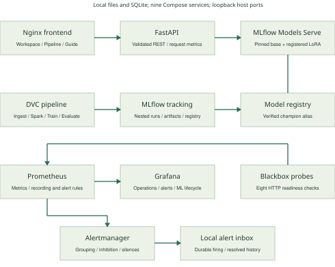
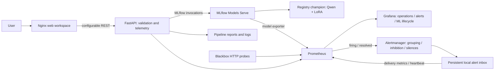
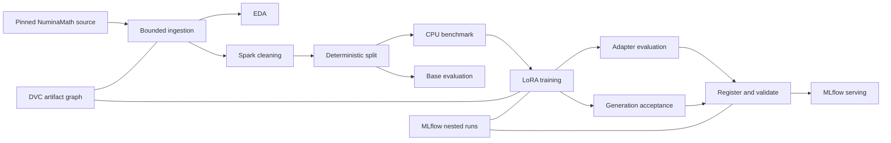

# Architecture

## Runtime path

The workspace and pipeline console are static frontend screens. FastAPI defines a narrow REST boundary. Model serving is a separate service using the registered executable pyfunc model. The web process does not load a second copy of the model. Prometheus scrapes API, pipeline, model-process, Grafana and its own operational metrics. Grafana provides service, incident and ML lifecycle dashboards. Prometheus evaluates seventeen alert rules and six recording rules. Blackbox probes check eight HTTP endpoints. Alertmanager groups, deduplicates, inhibits and routes firing/resolved notifications to the persistent local inbox. Seven metrics targets and the HTTP probes are scraped every fifteen seconds. The stack has nine Compose services with loopback-only host ports. See [the monitoring runbook](../monitoring/RUNBOOK.md) for thresholds and incident response.

## Build and experiment path

Environment inspection is an independent stage. EDA and Spark both depend on ingestion. Base evaluation depends on the held-out split; adapter evaluation additionally depends on training. The generation gate uses the saved adapter and predeclared prompts. Registration requires both adapter evaluation and acceptance evidence. The parent runner executes inspection, EDA and the requested dependency closure.

DVC caches datasets, split files, model directories and measured reports. MLflow stores training-step metrics, stage timings, run outcomes, output hashes, reports, source snapshots, dependency versions and registry decisions. The local submission archive includes the DVC object store; a separate restoration command reconstructs MLflow registration for a different folder path.

See [High-level design](high_level_design.md) for rationale, [Low-level design](low_level_design.md) for exact interfaces, and [Operator runbook](operator_runbook.md) for execution and rollback.
